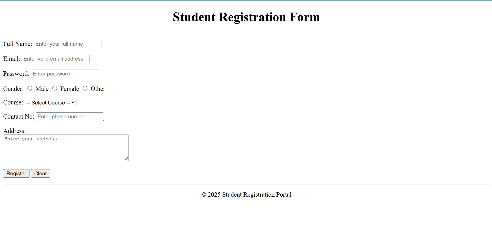
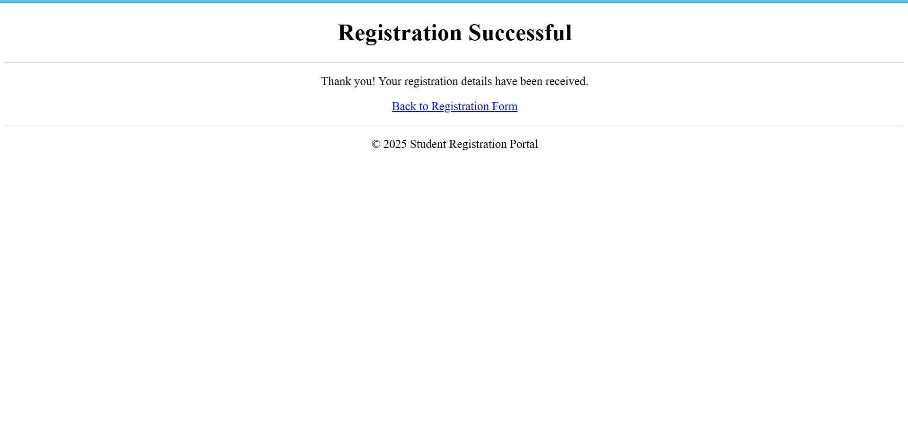

# Experiment 5 – Student Registration Form with Email Validation

A student registration form built with HTML that uses form attributes and basic email validation.

## Objectives
- Design a student registration form using HTML
- Apply form attributes:
  - `method` – defines how data is sent
  - `action` – defines where data is sent
  - `placeholder` – displays hint text
  - `required` – ensures mandatory fields are filled
- Implement basic email validation using `type="email"`

## Form Fields
- Full Name, Email, Password
- Gender (radio buttons)
- Course (dropdown)
- Contact No
- Address (textarea)
- **Register** and **Clear** buttons

## How to Run
1. Download or clone this repository
2. Open `index.html` in any web browser (or use the Live Server extension in VS Code)
3. Fill in the form and click **Register** to open `submit.html`

## Output

**Form filling (reg)**

**Successful registration (success)**

## Outcome
- Successfully created a **Student Registration Form** using only HTML
- Applied **form attributes**: method, action, placeholder, required
- Implemented **email validation** using `type="email"`
- Learned to design a **structured form** without CSS
